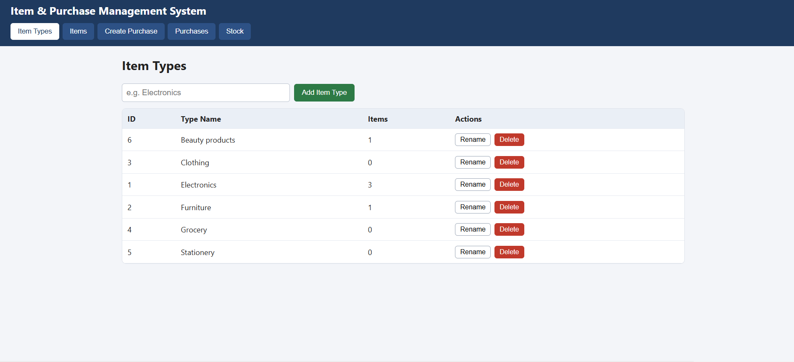
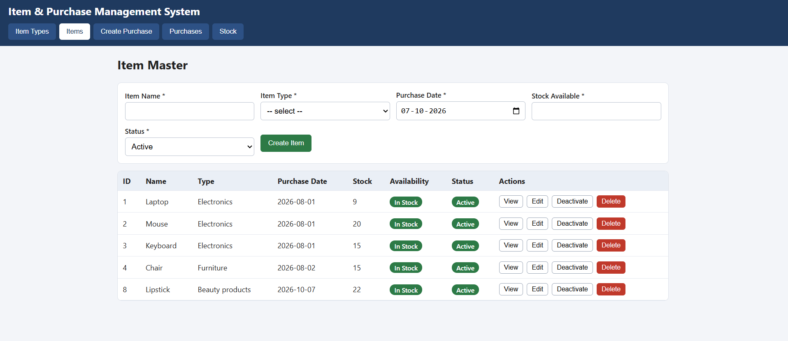
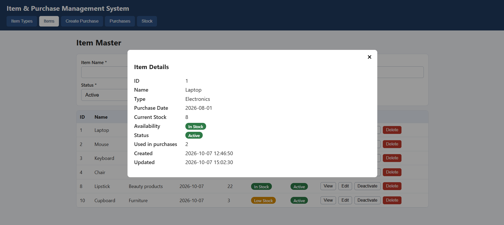
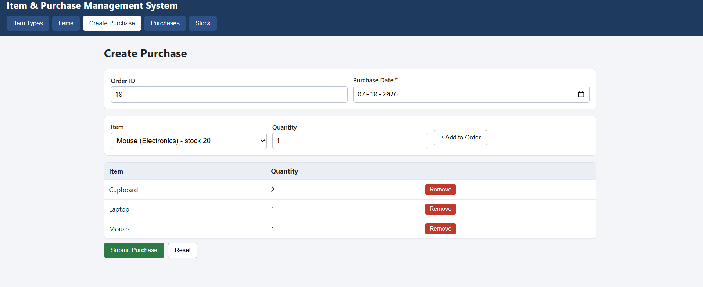
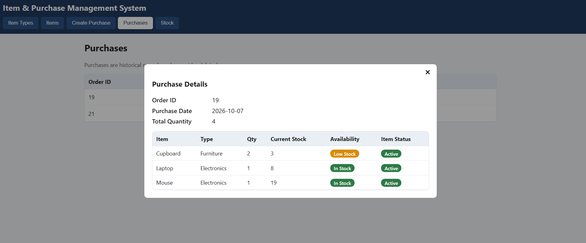
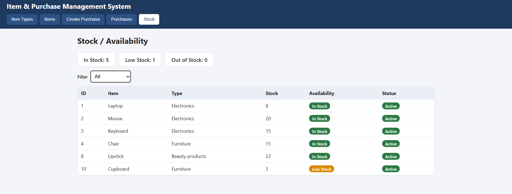
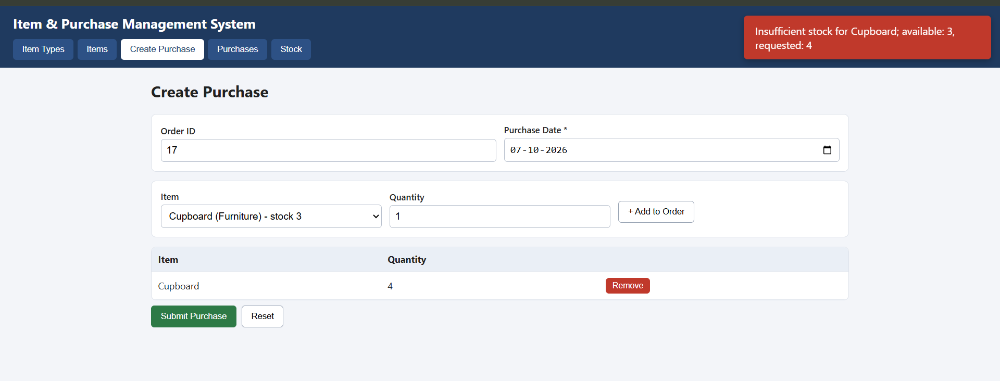
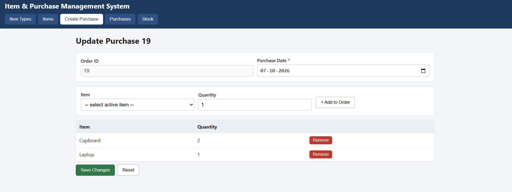
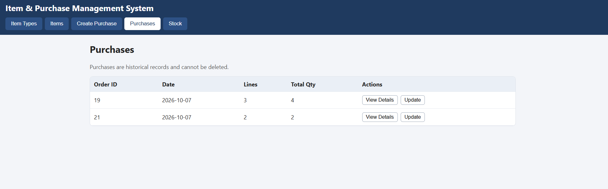
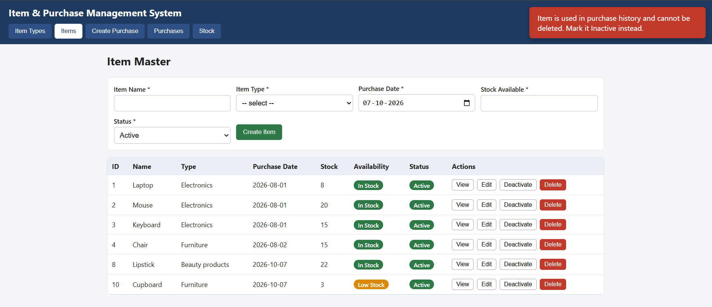

# Item and Purchase Management System

Submitted by: Jyoti
Date: 7-10-2026

A small web app for managing items, item types and purchase orders, with stock tracking. The backend is Node.js with Express, the database is MySQL, and the frontend is plain HTML, CSS and JavaScript. Express also serves the frontend, so there is only one server to start.

## What it does

- Add and manage item types (Electronics, Furniture, etc.)
- Add, edit, view, activate/deactivate and delete items
- Create a purchase with one Order ID and several items
- Reject a purchase if an item is inactive or the stock is too low
- Reduce stock when a purchase is saved
- Edit a purchase later; stock is adjusted by the difference between the old and new quantity
- Show every purchase with its items, and a stock page showing In Stock, Low Stock and Out of Stock

Purchases cannot be deleted. There is no delete route for them in the backend and no delete button in the UI. An item that appears in any purchase cannot be deleted either; it can only be marked inactive.

## Requirements

- Node.js 18 or newer
- MySQL 8.0 or newer

## How to run it

1. Create the database and tables (this also adds some sample data):

   ```
   mysql -u root -p < sql/schema.sql
   ```

2. Copy `.env.example` to `.env` and put your MySQL password in it:

   ```
   copy .env.example .env
   ```

   ```
   PORT=3000
   DB_HOST=localhost
   DB_PORT=3306
   DB_USER=root
   DB_PASSWORD=your_password
   DB_NAME=item_purchase_db
   ```

3. Install and start:

   ```
   npm install
   npm start
   ```

4. Open http://localhost:3000 in the browser.

## Database

Four tables, all in `sql/schema.sql`:

- `item_types` - the categories
- `items` - item master data and current stock, linked to `item_types`
- `purchases` - one row per order (unique `order_id`)
- `purchase_items` - the items and quantities in each order

Foreign keys use `ON DELETE RESTRICT`, so MySQL itself also refuses to delete something that purchase history depends on.

JOINs are used in two places. The item list joins `items` with `item_types`. The purchase details query joins `purchases`, `purchase_items`, `items` and `item_types`. Both are in `routes/items.js` and `routes/purchases.js`.

## How stock is handled

When a purchase is created, the backend starts a transaction, locks the rows of the items in the order, and checks that each item exists, is active and has enough stock. Then it inserts the purchase and its lines and subtracts the stock. If anything fails, the whole thing is rolled back and nothing is saved. The stock update also has a `stock_available >= quantity` condition, so stock cannot go below zero.

For updates, the difference is used. If stock is 10 and a purchase of 3 is changed to 5, 2 more are taken (stock 5). If it is later changed to 2, 3 are returned (stock 8). An increase is checked against available stock again.

If the same item is added twice in one order, the API rejects it with an error. The form on the page avoids this by adding the quantity to the existing line.

## API

All errors come back as `{ "error": "message" }`. Status codes used: 400 for invalid input, 404 for not found, 409 for business rule conflicts (insufficient stock, inactive item, item already used in a purchase) and 500 for unexpected errors.

Item types

- `GET /api/item-types`
- `POST /api/item-types` with `{ "type_name": "Toys" }`
- `PUT /api/item-types/:id`
- `DELETE /api/item-types/:id` (blocked if items use it)

Items

- `GET /api/items` (add `?active=1` for active items only)
- `GET /api/items/:id`
- `POST /api/items`
- `PUT /api/items/:id`
- `PATCH /api/items/:id/status` with `{ "active": false }`
- `DELETE /api/items/:id` (blocked if the item is in a purchase)

Purchases

- `GET /api/purchases`
- `GET /api/purchases/:id` (works with the numeric id or the order id like `PO-00001`)
- `POST /api/purchases`
- `PUT /api/purchases/:id`

Example body for creating an item:

```json
{
  "name": "Laptop",
  "item_type_id": 1,
  "purchase_date": "2026-08-25",
  "stock_available": 10,
  "active": true
}
```

Example body for creating a purchase (`order_id` is optional; if left out it becomes PO-00001, PO-00002 and so on):

```json
{
  "order_id": "PO-00001",
  "purchase_date": "2026-08-25",
  "items": [
    { "item_id": 1, "quantity": 2 },
    { "item_id": 2, "quantity": 5 }
  ]
}
```

Example with curl, this one should fail with 409 because of too much quantity:

```
curl -X POST http://localhost:3000/api/purchases -H "Content-Type: application/json" -d "{\"purchase_date\":\"2026-08-25\",\"items\":[{\"item_id\":1,\"quantity\":999}]}"
```

## Project layout

```
server.js           app setup and routes
db.js               MySQL connection pool
utils.js            validation helpers and error handler
routes/             itemTypes.js, items.js, purchases.js
public/             index.html, style.css, app.js
sql/schema.sql      tables and sample data
screenshots/        screenshots used below
```

## Screenshots

Item types



Item list and form



Item details



Creating a purchase with three items



Purchase details after saving



Stock after the purchase (Laptop 10 -> 8, Mouse 20 -> 15, Chair 15 -> 12)



Rejected when the quantity is more than the stock



Updating a purchase



Purchase list, no delete option



Deleting an item that was already purchased is blocked



## Testing I did

- Created Order PO-00001 with Laptop 2, Mouse 5, Chair 3. Stock became 8, 15 and 12.
- Tried to order 10 Laptops with 8 in stock. It was rejected and stock stayed the same.
- Changed a purchase quantity up and down and checked the stock each time.
- Marked an item inactive and confirmed it no longer shows in the purchase form.
- Tried to delete an item that was in a purchase. It was blocked.
- Sent a request to `DELETE /api/purchases/1`. The server returns 404 because the route does not exist.
